# eyeExtend Connect Active Directory Guide

The Active Directory Connect app enables Forescout to communicate directly with Active Directory over LDAPv3, providing computer and user identity resolution, account-status information, group-membership visibility, and controlled group-management actions.

## Contents

- [Capabilities](#capabilities)
- [Requirements](#requirements)
- [Deployment Options and Installation Checklist](#deployment-options-and-installation-checklist)
- [Installation and Update](#installation-and-update)
- [Connect Configuration](#connect-configuration-system-description)
- [Import the Group Structure](#import-the-group-structure)
- [Deploy Policy Templates](#deploy-policy-templates)
- [Writing to Active Directory](#writing-to-active-directory-addremove-group-membership)
- [Enablement and Validation](#enablement-and-validation)

## Capabilities

- Communicate with Active Directory
  - Supported security methods
    - LDAPS
    - LDAP with required StartTLS
    - Plaintext LDAP
  - LDAPS and StartTLS support server certificate validation with optional CRL revocation status checking
  - Domain controller automatic discovery or failover to specified domain controllers
- Resolve objects
  - Resolves computer objects using collected object GUIDs, DNS names, NetBIOS names, and DHCP hostnames
  - Resolves user objects using collected GUIDs, DOMAIN\username, UPN, or username
  - Restricts object searches to specified user and computer OUs when configured
- Present directory data
  - Reports the matched object’s DN, GUID, match method, confidence, account state, expiration details, lookup time, and responding domain controller
  - Retrieves direct AD group memberships, including the account’s primary group
  - Includes policy templates for GUID collection from managed Windows endpoints, object matching, group checks, and stale user-match cleanup
- Change direct group membership
  - **Add AD computer to group** and **Add AD user to group** can optionally remove membership when Forescout cancels the action
  - **Remove AD computer from group** and **Remove AD user from group** can optionally restore membership when Forescout cancels the action

> [!NOTE]
> For basic read-only visibility into logged-in user groups, the native Forescout User Directory plugin may already provide the required data. Deploy the Connect AD **User Object** templates when GUID-backed user identity, Connect AD user properties, or user group-membership writes are required.

### Use Cases

The app supports two broad types of workflows: reading Active Directory identity, account state, and group-membership data for policy and reporting; and making controlled computer or user group-membership changes that drive downstream enforcement.

#### Read Computer Data Use Cases

These examples use **[Connect AD] Computer Object** and **[Connect AD] Computer Groups** without changing Active Directory. They focus on computer context because the native Forescout User Directory plugin is the intended source for read-only user identity and group data. Connect AD user-object data remains available to support the app's controlled user group-membership actions and their identity checks.

| Use case | Computer data read | Forescout outcome and implementation notes |
| --- | --- | --- |
| **AD-aware NAC and policy decisions** | Computer object DN, OU placement inferred from the DN, and direct or primary group membership. | Apply different admission, segmentation, inspection, or remediation policies to computers assigned to high-security, restricted, production, lab, kiosk, server, or other purpose-built AD groups or OUs. AD classification becomes an additional policy signal rather than the only proof that a device is trusted. |
| **Computer identity and domain-registration validation** | Object GUID, DN, match method, match confidence, and lookup result. | Confirm that an observed endpoint maps to one expected AD computer object. Missing, ambiguous, or low-confidence matches can identify renamed, rebuilt, duplicated, incorrectly joined, or unmanaged devices and trigger investigation or restricted access. The app does not directly test the Windows secure channel or machine-account password freshness. |
| **Disabled or expired computer enforcement** | Account-disabled, account-expired, and expiration-set status. | Restrict or block a network-active computer whose AD account is disabled or expired, and alert on conflicts between current network activity and the directory lifecycle state. Account expiration is distinct from password expiration. |
| **High-value asset monitoring** | Membership in designated high-value asset, crown-jewel, domain-controller, infrastructure, executive-device, or regulated-system groups. | Add enhanced inspection, logging, behavioral baselines, alerting, or incident-response priority to especially sensitive computers. Direct group membership is context for stronger monitoring, not proof that the endpoint is healthy. |
| **Elevated-access risk correlation** | Membership in computer groups associated with privileged administration, sensitive applications, production management, or broader network access. | Combine the computer's elevated AD context with Forescout posture, vulnerability, traffic, EDR, or compromise evidence. A privileged or high-impact computer that becomes non-compliant can receive faster escalation or tighter restrictions than a standard workstation. Read-only user context, when needed, should come from the User Directory plugin. |
| **Exception and waiver targeting** | Membership in an approved exception, maintenance, legacy-system, or compensating-control group. | Exclude a computer from a specific compliance or remediation rule when an explicit AD-managed exception exists, while continuing to inventory, monitor, and report the exception. Prefer narrow policy exclusions and compensating controls over exempting the device from all security policy. |
| **Operational coordination through groups** | Membership in groups maintained by help desk, desktop engineering, imaging, software deployment, security operations, or other IT teams. | Treat an AD group as a shared, auditable coordination signal. A team can place a computer in a group such as imaging in progress, pending repair, approved for rebuild, software rollout, or investigation hold, and Forescout can automatically apply the corresponding handling without a separate ticket-system integration. |
| **Imaging and provisioning workflow awareness** | Membership in build, staging, imaging, burn-in, acceptance-testing, or production-ready groups. | Give newly imaged devices temporary network access to deployment services, suppress premature production compliance findings, or apply a staging policy until another team moves the computer into its production group. Use time limits or reconciliation so devices do not remain indefinitely in transitional states. |
| **Software and configuration rollout alignment** | Membership in pilot, deployment-ring, application, patch-wave, or configuration groups. | Align Forescout policy with AD-based software deployment and endpoint-management workflows. Forescout can recognize pilot devices, tolerate an approved transition state, verify expected security controls, or add monitoring during a risky rollout without changing the deployment group's membership. |
| **Incident-response and investigation holds** | Membership in watchlist, suspected-compromise, forensic-hold, or active-investigation groups. | Increase monitoring, preserve access needed by responders, limit unrelated access, or prevent automated cleanup policies from disrupting an investigation. This lets incident responders communicate handling requirements through an existing directory control point. |
| **Role and classification drift detection** | Current computer DN and direct or primary groups compared with Forescout classification, network location, function, ownership, or expected baseline. | Find computers whose AD placement conflicts with observed behavior or inventory, such as a server account used by a workstation, a production asset in a lab OU, or a kiosk placed in a general workstation group. Route discrepancies to the owning AD, CMDB, endpoint-management, or operations team. |
| **Lifecycle and retirement reconciliation** | Computer match status, DN, account state, and current group membership. | Identify decommissioned or disabled computer accounts that are still active on the network, and active managed devices whose expected AD object is missing. Use the discrepancy to investigate stale records, incomplete retirement, reimaging errors, or unauthorized reuse rather than automatically assuming which system is authoritative. |
| **Critical-service safeguards** | Membership in groups identifying systems that provide DNS, directory, management, remediation, safety, manufacturing, or other critical services. | Prevent broad quarantine or disruptive remediation from being applied blindly to critical computers. Route them to a purpose-built containment policy that preserves required dependencies while increasing monitoring and escalating for human approval. |
| **Policy ownership and response routing** | OU placement or group membership that identifies a business unit, platform team, service owner, support queue, or administrative boundary. | Send alerts, reports, or remediation requests to the correct team and apply team-specific maintenance windows or response procedures. Directory organization becomes a routing signal without duplicating every ownership mapping inside Forescout. |

#### Group Change Use Cases

The following examples show how the app's add/remove group actions can change computer or user group membership and drive controls in systems that consume Active Directory groups.

| Use case | Forescout trigger or evidence | AD group change | Downstream result and implementation notes |
| --- | --- | --- | --- |
| **VPN access segmentation** | A VPN-connected computer is unmanaged, missing required security software, or fails a compliance check. | Add the computer or user to a restricted VPN group; remove it after approved remediation. | A VPN concentrator or policy service that evaluates computer/user-group membership assigns a limited-access profile. Confirm that the VPN product actually evaluates AD account membership. Reauthentication or token refresh may be required. |
| **Restrictive Group Policy for non-compliant computers** | A managed Windows computer fails posture, firewall, encryption, EDR, prohibited-software, or configuration requirements. | Add the computer to a security-filtering group associated with a restrictive GPO; remove it after remediation. | The GPO can restrict Windows Firewall access to domain controllers and remediation services, display a warning background or lock-screen message, disable removable storage, or apply other hardening. Computer-token refresh, Group Policy refresh, and sometimes a restart are required. User-interface restrictions may require user policy or loopback processing. Never block DNS, domain controllers, Forescout, management, or remediation services needed for recovery. |
| **Network quarantine or remediation** | Forescout detects malware, lateral movement, a failed health check, or an unhealthy security agent. | Add the computer to an isolation or remediation group. | Group-aware firewalls, including the native Windows firewall, proxies, group-aware endpoint security products, or other controls restrict the endpoint to remediation infrastructure. Use direct NAC or firewall enforcement when immediate containment is required; AD group propagation is not instantaneous. |
| **Conditional application access** | A computer or user does not satisfy the requirements for a sensitive application. | Remove the account from the entitlement group, or add it to a restriction group; reverse the change after validation. | Existing AD-integrated applications enforce the changed entitlement without a custom Forescout integration. Confirm whether the application consumes user or computer groups and how often it refreshes authorization data. |
| **Privileged-access protection** | A privileged user signs in from an unmanaged, non-compliant, or unexpected endpoint. | Remove the user from an approved access group or add the user to a restricted-access group. | Administrative portals, jump hosts, VPN profiles, and other group-aware systems can limit access until the endpoint is trusted. Do not delegate the Connect bind account write access to highly privileged groups; use a purpose-built gate or restriction group instead. |
| **Incident-response containment** | Forescout identifies suspicious traffic, malware, lateral movement, or evidence of a compromised account or device. | Add the computer or user to a containment group. | Downstream systems block or reduce VPN, application, file-share, or network access while the incident is investigated. Automatic undo is usually inappropriate unless the incident-response team explicitly approves it. |
| **Contractor and temporary access** | An approved engagement begins or ends, or a contractor is observed on an approved managed endpoint. | Add or remove the user from a limited-access or project group. | Access follows the approved engagement and endpoint context. Use a defined expiration/removal workflow so temporary membership does not become permanent. |
| **User access based on endpoint posture** | A user is observed on a managed and compliant endpoint, or moves to an untrusted endpoint. | Add or remove the user from a conditional entitlement group. | AD-integrated services grant access only while the user is associated with an acceptable endpoint. Require `Trusted User Object Match`, a current user, and a clear strategy for multiple or disconnected sessions. |
| **Device onboarding** | A new computer has the required management agent, encryption, EDR, certificate, and baseline configuration. | Add the computer to a production-ready or managed-device group. | Software deployment, certificate enrollment, configuration management, VPN, or network controls can recognize that the endpoint is ready. Automatic undo may be undesirable if onboarding represents a durable administrative state. |
| **Device retirement** | A computer is stale, decommissioned, replaced, or no longer managed. | Remove it from application, deployment, VPN, or production-access groups. | Old computer accounts lose downstream entitlements without requiring an administrator to find every consuming system. Coordinate this with the authoritative asset-retirement and AD-account lifecycle process. |
| **Phased software or security-policy rollout** | Devices meet selected department, operating-system, location, readiness, or pilot criteria. | Add computers to a deployment-ring group and remove them when the rollout stage is complete. | AD-based deployment and management tools can use the group for pilot, phased, emergency, or rollback assignments. Leave undo disabled when the deployment system must finish independently of the original match. |
| **License or resource assignment** | Forescout confirms that a user or device is active and eligible for a licensed application or restricted resource. | Add the account to the entitlement group and remove inactive or ineligible members. | AD membership drives assignment while reducing unused licenses and stale access. Verify that Forescout evidence is authoritative enough for entitlement decisions and define how membership is reconciled with the system of record. |
| **Location-sensitive access** | A user or computer appears on an unauthorized site, VLAN, network, or geographic context. | Add the account to a restricted group or remove it from a location-specific access group. | Group-aware applications or infrastructure apply a reduced-access profile. Account for roaming, VPN address translation, delayed location signals, and downstream authorization caching. |


### Conditions and Properties

In the reference tables, **bold** text identifies a Console-visible label. `Code` text identifies an internal name, schema field, literal value, filename, AD attribute, or exact configured object name.

| Console condition/property | Example | Internal name and shape | Purpose and behavior | Complete composite schema | Resolution inputs and operational details |
| --- | --- | --- | --- | --- | --- |
| **[Connect AD] Computer Object** | <a href="images/19-computer-object-property.png">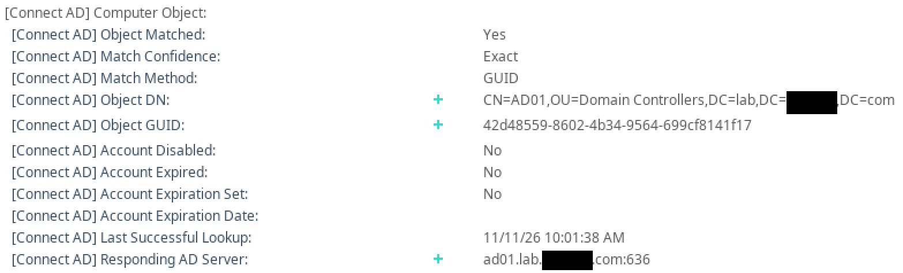</a> | **Internal name**<br>`connect_activedirectory_computer_object`<br><br>**Shape**<br>Type: `composite`<br>Resolvable: `true`<br>Asset Portal: `true` | Latest complete, successful, unambiguous AD computer-object lookup. Exact GUID evidence is preferred; name evidence is evaluated within the configured domain and optional computer search base. | `matched` — **Object Matched**, `boolean`; true only after one object is matched.<br><br>`match_confidence` — **Match Confidence**, `string` enum: `Exact`, `High`, `Medium`, `Low`.<br><br>`match_method` — **Match Method**, `string` enum: `GUID`, `NetBIOS hostname`, `DHCP hostname`, `DNS name`, `DNS-derived account name`.<br><br>`dn` — **Object DN**, `string`; full account DN.<br><br>`guid` — **Object GUID**, `string`; AD `objectGUID` rendered as a UUID.<br><br>`disabled` — **Account Disabled**, `boolean`; `ACCOUNTDISABLE` flag.<br><br>`expired` — **Account Expired**, `boolean`; account expiration has passed, not password expiration.<br><br>`expiration_set` — **Account Expiration Set**, `boolean`; false for either never-expire sentinel.<br><br>`expiration` — **Account Expiration Date**, `date`; UTC epoch value, omitted when the account never expires.<br><br>`checked_at` — **Last Successful Lookup**, `date`; UTC epoch lookup time.<br><br>`server` — **Responding AD Server**, `string`; `hostname:port`. | Re-resolves when `hostname`, `hostnames_list`, `nbthost`, `nbtdomain`, `dhcp_hostname_v2`, or `connect_activedirectory_managed_computer_guid_script_details` is new or changes. Match strength is based on the identifier that actually matched; reading `objectGUID` after a name lookup does not promote the match to Exact. Lookup failure returns an error rather than a partial composite. |
| **[Connect AD] Computer Groups** | <a href="images/20-computer-groups-property.png">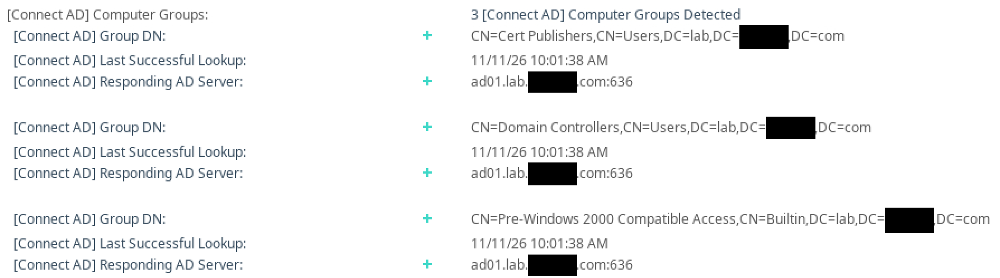</a> | **Internal name**<br>`connect_activedirectory_computer_group_details`<br><br>**Shape**<br>Type: `composite`<br>List: `true`<br>Overwrite: `true`<br>Resolvable: `true`<br>Inventory: `true`<br>Asset Portal: `true` | Latest complete computer membership snapshot. One row is returned for each direct AD group DN, including the account's primary group. Nested memberships are not expanded. | `group_dns` — **Group DN**, `string`; full direct or primary group DN and the inventory key.<br><br>`checked_at` — **Last Successful Lookup**, `date`; UTC epoch membership-read time.<br><br>`server` — **Responding AD Server**, `string`; `hostname:port`. | Depends only on `connect_activedirectory_computer_object`. The resolver uses the matched object's GUID, reads live membership, and replaces the previous list only after a complete successful lookup. An account with no linked `memberOf` values still returns its primary-group row. |
| **[Connect AD] Managed Computer Object GUID Script Result** | <a href="images/21-managed-computer-guid-property.png">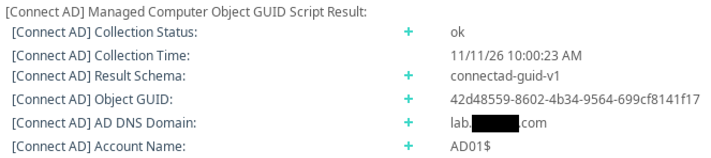</a> | **Internal name**<br>`connect_activedirectory_managed_computer_guid_script_details`<br><br>**Shape**<br>Type: `composite`<br>Resolvable: `true`<br>Asset Portal: `true` | Parsed computer evidence from the endpoint GUID collector. Parsing is local and does not contact AD. The property is absent when the raw script result is absent. | `status` — **Collection Status**, `string`; collector-reported status with no registered Console enum restriction.<br><br>`collected_at` — **Collection Time**, `date`; endpoint UTC epoch time.<br><br>`schema` — **Result Schema**, `string`; accepted parser schemas are `connectad-guid-v1` and `nativead-guid-v1`.<br><br>`guid` — **Object GUID**, `string`; collected computer GUID when available.<br><br>`domain` — **AD DNS Domain**, `string`.<br><br>`sam` — **Account Name**, `string`; collected `sAMAccountName`. | Depends on `script_result.b249e1c035a662f102d2aba7094d9777`. New or changed raw script evidence re-runs the parser. Invalid JSON, an unsupported schema, contradictory data, or invalid field types make the property irresolvable. |
| **[Connect AD] User Object** | <a href="images/22-user-object-property.png">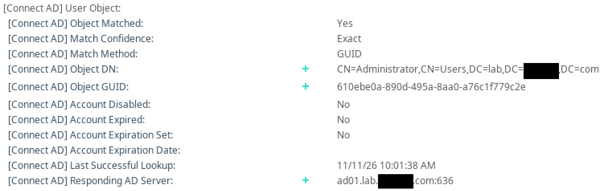</a> | **Internal name**<br>`connect_activedirectory_user_object`<br><br>**Shape**<br>Type: `composite`<br>Resolvable: `true`<br>Asset Portal: `true` | Latest complete, successful, unambiguous AD user-object lookup for the current observed identity. A completed no-user observation clears the prior User Object and User Groups values. | `matched` — **Object Matched**, `boolean`.<br><br>`match_confidence` — **Match Confidence**, `string` enum: `Exact`, `High`, `Medium`, `Low`.<br><br>`match_method` — **Match Method**, `string` enum: `GUID`, `Domain-qualified username`, `User principal name`, `Unqualified username`.<br><br>`dn` — **Object DN**, `string`.<br><br>`guid` — **Object GUID**, `string` UUID.<br><br>`disabled` — **Account Disabled**, `boolean`.<br><br>`expired` — **Account Expired**, `boolean`.<br><br>`expiration_set` — **Account Expiration Set**, `boolean`.<br><br>`expiration` — **Account Expiration Date**, `date`; UTC epoch value when set.<br><br>`checked_at` — **Last Successful Lookup**, `date`; UTC epoch lookup time.<br><br>`server` — **Responding AD Server**, `string`; `hostname:port`. | Re-resolves when `user`, `va_comp_users_logged_in`, `linux_logged_users`, `mac_logged_users`, or `connect_activedirectory_managed_user_guid_script_details` is new or changes. Domain-qualified usernames and UPNs are High confidence; an unqualified username scoped by the configured domain is Medium. Missing, conflicting, local, ambiguous, or stale user evidence is not silently reused. |
| **[Connect AD] User Groups** | <a href="images/23-user-groups-property.png">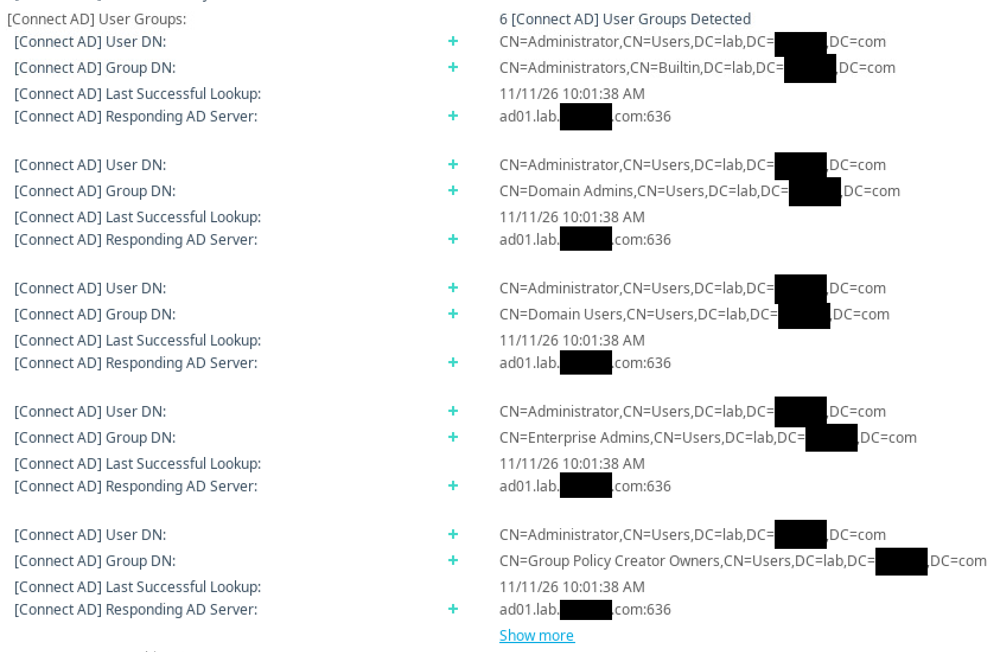</a> | **Internal name**<br>`connect_activedirectory_user_group_details`<br><br>**Shape**<br>Type: `composite`<br>List: `true`<br>Overwrite: `true`<br>Resolvable: `true`<br>Inventory: `true`<br>Asset Portal: `true` | Latest complete user membership snapshot. One row is returned for every direct group and the primary group; nested membership is excluded. | `user_dn` — **User DN**, `string`; matched user's full DN, repeated in every row.<br><br>`group_dns` — **Group DN**, `string`; full direct or primary group DN and the inventory key.<br><br>`checked_at` — **Last Successful Lookup**, `date`; UTC epoch membership-read time.<br><br>`server` — **Responding AD Server**, `string`; `hostname:port`. | Depends only on `connect_activedirectory_user_object`. Membership is read live using the matched user GUID. A successful no-current-user resolution clears the list. Failed, unreadable, ambiguous, or incomplete membership reads do not publish a partial list. |
| **[Connect AD] Managed User Object GUID Script Result** | <a href="images/24-managed-user-guid-property.png">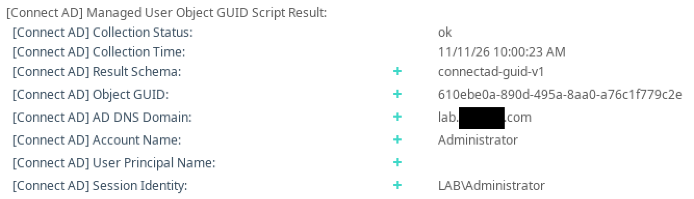</a> | **Internal name**<br>`connect_activedirectory_managed_user_guid_script_details`<br><br>**Shape**<br>Type: `composite`<br>Resolvable: `true`<br>Asset Portal: `true` | Parsed current-user evidence from the endpoint GUID collector. A `no_active_user` observation deliberately retains status, collection time, and schema so policy can remove stale user context. | `status` — **Collection Status**, `string` enum: `ok`, `error`, `not_domain_joined`, `no_active_user` (displayed as **No user**), `multiple_active_users`, `not_ad_user`, `session_changed`.<br><br>`collected_at` — **Collection Time**, `date`; endpoint UTC epoch time.<br><br>`schema` — **Result Schema**, `string`; accepted parser schemas are `connectad-guid-v1` and `nativead-guid-v1`.<br><br>`guid` — **Object GUID**, `string`; optional.<br><br>`domain` — **AD DNS Domain**, `string`; optional.<br><br>`sam` — **Account Name**, `string`; optional `sAMAccountName`.<br><br>`upn` — **User Principal Name**, `string`; optional.<br><br>`identity` — **Session Identity**, `string`; observed domain and username when available. | Depends on `script_result.b249e1c035a662f102d2aba7094d9777`. Negative statuses retain only applicable metadata and clear contradictory optional identity fields. Multiple active accounts are not chosen arbitrarily. Parsing never contacts AD. |
| **[Connect AD] Last group action** | <a href="images/25-last-group-action-property.png">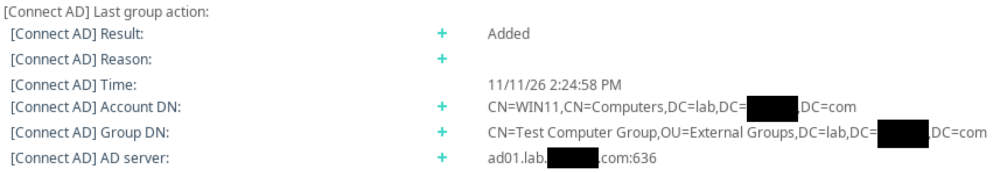</a> | **Internal name**<br>`connect_activedirectory_action_status`<br><br>**Shape**<br>Type: `composite`<br>Resolvable: `false`<br>Asset Portal: `true` | Records the most recent computer or user membership action, including confirmed no-op, failure, unknown write outcome, cancellation, and post-write refresh warning information. | `result` — **Result**, `string`; success values include `Added`, `Removed`, `Already present`, `Already absent`, and `Already present (AD primary group)`; cancellation may use `Undone: …` or `Cancelled: …`; errors use `Failed` or `Unknown`.<br><br>`reason` — **Reason**, `string`; failure or warning details.<br><br>`time` — **Time**, `date`; UTC epoch action time.<br><br>`object_dn` — **Account DN**, `string`; included only after fresh resolution.<br><br>`group_dn` — **Group DN**, `string`; validated action target.<br><br>`server` — **AD server**, `string`; last attempted or successful `hostname:port`. | Written by actions rather than independently resolved. `Unknown` means a write may have reached AD but could not be verified; policy or an operator must re-read membership before retrying. A confirmed write whose subsequent Groups refresh fails remains successful and records the refresh warning in `reason`. |


### Actions

| Console action and internal name | Operation and directory behavior | Arguments | Identity dependencies | Results, cancellation, authorization, and safety behavior |
| --- | --- | --- | --- | --- |
| **Add AD computer to group**<br><br>`connect_activedirectory_add_computer_group` | Ensures the freshly resolved computer is a direct member of the exact group DN. Adding an existing direct membership or the computer's primary group is a successful idempotent no-op. After confirmed membership, the app re-reads the account by GUID and publishes a complete live `connect_activedirectory_computer_group_details` snapshot from the same DC. | `connect_activedirectory_group_dn` — **Full group DN**, `string`, default empty. Must be a syntactically valid, full in-domain DN that resolves by base search to exactly one visible `objectClass=group` object.<br><br>`connect_activedirectory_undo_on_cancel` — **Undo when action cancelled**, `boolean`, default `true`. | Re-resolves from `hostname`, `hostnames_list`, `nbthost`, `nbtdomain`, `dhcp_hostname_v2`, and `script_result.b249e1c035a662f102d2aba7094d9777`. Fresh identity ambiguity or definitive negative collector evidence blocks the write. | Writes `connect_activedirectory_action_status` and, after confirmed membership, refreshed Computer Groups. Enforces `connect_activedirectory_computer_group_whitelist`; a blank whitelist blocks changes. `connect_activedirectory_computer_allow_any_group=false` by default and is the explicit dangerous bypass.<br><br>Undo label: **Cancel AD computer group add**. Cancellation removes the member only if this action added it, undo was enabled, the saved account and group GUIDs still match, the group remains authorized, and the original DC remains configured. Undo state uses a bounded `connectad-group-undo-v1` cookie.<br><br>The app compares membership before writing, rechecks account and group GUIDs immediately before one LDAP Modify, verifies membership on the same DC, and never retries an unknown write on another DC. |
| **Remove AD computer from group**<br><br>`connect_activedirectory_remove_computer_group` | Ensures the freshly resolved computer is not a direct member of the exact group DN. Removing an already absent membership is a successful idempotent no-op. Removing or reassigning the computer's AD primary group is explicitly rejected. A confirmed result triggers a complete live Computer Groups refresh from the same DC. | `connect_activedirectory_group_dn` — **Full group DN**, `string`, default empty; exact visible in-domain group DN only.<br><br>`connect_activedirectory_undo_on_cancel` — **Undo when action cancelled**, `boolean`, default `true`. | Same computer inputs as the add action: `hostname`, `hostnames_list`, `nbthost`, `nbtdomain`, `dhcp_hostname_v2`, and raw GUID collector result `script_result.b249e1c035a662f102d2aba7094d9777`. | Uses the computer whitelist and dangerous allow-any setting described above. Writes Last group action plus refreshed Computer Groups after verification.<br><br>Undo label: **Cancel AD computer group remove**. Cancellation restores the original direct membership only when the forward action actually removed it and all saved-identity, current-whitelist, and original-DC checks pass.<br><br>Unknown or unverifiable writes return `result=Unknown`, keep the attempted server and freshly resolved account DN when available, and are not replayed through failover. |
| **Add AD user to group**<br><br>`connect_activedirectory_add_user_group` | Ensures the freshly resolved current AD user is a direct member of the exact group DN. Existing direct or primary membership is a successful idempotent no-op. After verification, the app re-resolves the account by GUID and publishes a complete live `connect_activedirectory_user_group_details` snapshot. | `connect_activedirectory_group_dn` — **Full group DN**, `string`, default empty; exact visible in-domain group DN only.<br><br>`connect_activedirectory_undo_on_cancel` — **Undo when action cancelled**, `boolean`, default `true`. | Re-resolves from `user`, `va_comp_users_logged_in`, `linux_logged_users`, `mac_logged_users`, and `script_result.b249e1c035a662f102d2aba7094d9777`. Local-user markers, conflicting identities, multiple active users, session-mismatched collector evidence, or ambiguity block the write. | Enforces `connect_activedirectory_user_group_whitelist`; blank blocks changes. `connect_activedirectory_user_allow_any_group=false` by default and is the explicit dangerous bypass. Writes Last group action and refreshed User Groups.<br><br>Undo label: **Cancel AD user group add**. Cancellation removes only membership owned by the original action and only when undo, identity, authorization, and original-DC checks pass. The undo cookie schema is `connectad-group-undo-v1`.<br><br>The user is freshly resolved for every forward write; the app never changes membership based only on a cached DN or friendly group name. |
| **Remove AD user from group**<br><br>`connect_activedirectory_remove_user_group` | Ensures the freshly resolved current AD user is not a direct member of the exact group DN. Already absent is a successful idempotent no-op. Removal of the user's AD primary group is rejected because changing `primaryGroupID` is unsupported. A confirmed result triggers a complete live User Groups refresh. | `connect_activedirectory_group_dn` — **Full group DN**, `string`, default empty; exact visible in-domain group DN only.<br><br>`connect_activedirectory_undo_on_cancel` — **Undo when action cancelled**, `boolean`, default `true`. | Same user inputs as the add action: `user`, `va_comp_users_logged_in`, `linux_logged_users`, `mac_logged_users`, and raw GUID collector evidence. | Uses the user whitelist and dangerous allow-any setting described above. Writes Last group action plus refreshed User Groups after same-DC verification.<br><br>Undo label: **Cancel AD user group remove**. Cancellation restores the direct membership only if the original action removed it and the recorded domain, account GUID, group GUID, server, and current authorization remain valid.<br><br>A transport failure after a write attempt produces an unknown outcome and no failover write. A later Groups refresh failure does not erase a verified action or its undo cookie; it is recorded as a warning in `reason`. |

## Requirements

- [eyeExtend Connect is installed, running, and licensed](#installation-and-update) on the Forescout platform
- A Forescout administrator can [import or update the app](#installation-and-update), [edit policy templates](#deploy-policy-templates), and [import or create the supporting Forescout groups](#import-the-group-structure)
- The [assigned Forescout Appliance](#assign-counteract-devices) can reach the configured [DNS resolvers and/or domain controllers](#servers-and-failover) on the selected LDAP(S) port
- For LDAPS or StartTLS, the Forescout trust store contains the issuing certificate chain; if CRL checking is enabled, the required current CRLs are also available; confirm the resulting [TLS, certificate, and CRL behavior with the connection test](#connection-validation)
- Managed Windows endpoints can run the Windows Expected Script Result inspection; when the GUID collector is used, follow the [collector deployment procedure](#collect-computeruser-object-guids-policy) and retain the exact filename `ConnectAD-CollectObjectGuids.bat`

### Active Directory Bind Account

Use a dedicated bind identity in UPN or full distinguished name format. Keep the account unprivileged and [delegate only the required Active Directory permissions](#delegate-the-bind-account-permission) for the selected deployment option. Enter and test the identity as part of the [Active Directory connection](#active-directory-connection).

| **Use** | **Required permission** | **Recommended scope** |
| --- | --- | --- |
| Read-only | Authenticate and read the computer, user, and group objects and attributes used by the app, including object identity, account name, membership, primary group, and account state data. | The configured [computer and user search bases](#object-search) plus the group objects whose membership is reported. |
| Add or remove computer accounts | All read permissions plus [write permission to the group `member` attribute](#delegate-the-bind-account-permission) on each approved computer group. | Only the full group DNs entered in the [computer whitelist](#computer-group-whitelist). Do not grant broad write access to computer OUs. |
| Add or remove user accounts | All read permissions plus [write permission to the group `member` attribute](#delegate-the-bind-account-permission) on each approved user group. | Only the full group DNs entered in the [user whitelist](#user-group-whitelist). Do not grant broad write access to user OUs. |

> [!IMPORTANT]
> A blank whitelist blocks all group changes. The **Allow any group** option bypasses the whitelist for that object type and should remain disabled unless a separately approved design requires it. Review [how the group whitelists fail closed](#configure-the-group-whitelists) and [require a trusted object match](#require-a-trusted-object-match) before enabling any write action.

## Deployment Options and Installation Checklist

Use the deployment table to select the required policy set and least-privilege bind permissions, then complete the checklist once for the chosen design. Items related to group writes apply only when computer or user membership changes are enabled.

### Deployment Options

| **Deployment goal** | **Policies and configuration** | **Bind account permissions** |
| --- | --- | --- |
| Read computer and/or user data | [Configure the app connection](#active-directory-connection). Use [**Collect Computer/User Object GUIDs**](#collect-computeruser-object-guids-policy) to gather exact object GUIDs from endpoints for `Exact` matches to AD. User Object templates are not required for basic read-only logged-in-user group visibility when the native User Directory plugin supplies it. | [Directory read access only](#active-directory-bind-account). |
| Change computer group membership | Use [**Collect Computer/User Object GUIDs**](#collect-computeruser-object-guids-policy), [**Computer Object Match Status**](#computer-object-match-status), and [**Computer Group Check**](#computer-group-check). Configure the [computer group whitelist](#computer-group-whitelist) before enabling any write action. | Read access plus [permission to write the `member` attribute](#delegate-the-bind-account-permission) on only the approved computer groups. |
| Change user group membership | Use [**Collect Computer/User Object GUIDs**](#collect-computeruser-object-guids-policy), [**User Object Match Status**](#user-object-match-status), and [**User Group Check**](#user-group-check). Configure [**User Cleanup on Logoff**](#user-cleanup-on-logoff) and the [user group whitelist](#user-group-whitelist). | Read access plus [permission to write the `member` attribute](#delegate-the-bind-account-permission) on only the approved user groups. |

> [!NOTE]
> The [Collect Computer/User Object GUIDs](#collect-computeruser-object-guids-policy) policy only needs to be deployed once regardless of the selected deployment option. Its single script execution returns both computer and active-user `objectGUID` information, so separate computer and user collector policies are not required.

### Installation Checklist

Complete **Basic Setup** for every deployment. Then complete the read-data section and each group-membership section that applies to the selected deployment goal.

#### Basic Setup — All Deployment Goals

- [ ] Choose the deployment goal or goals and required policy set from the [table above](#deployment-options)
- [ ] [Install the Connect app](#installation-and-update)
- [ ] [Configure and test an AD connection for each domain](#connect-configuration-system-description)

#### Read Computer and/or User Data

- [ ] [Import the app groups](#import-the-group-structure)
- [ ] [Deploy **Collect Computer/User Object GUIDs**](#collect-computeruser-object-guids-policy)
- [ ] [Deploy Computer Object policies when computer data or computer writes are in scope](#computer-object-policy-templates)
  - [ ] [**Computer Object Match Status**](#computer-object-match-status)
  - [ ] [**Computer Group Check**](#computer-group-check)
- [ ] [Deploy User Object policies when Connect AD user properties or user writes are in scope](#user-object-policy-templates)
  - [ ] [**User Cleanup on Logoff**](#user-cleanup-on-logoff)
  - [ ] [**User Object Match Status**](#user-object-match-status)
  - [ ] [**User Group Check**](#user-group-check)
- [ ] Complete [Read-Only Validation](#read-only-validation)

#### Change Computer Group Membership

- [ ] Complete [Basic Setup](#basic-setup--all-deployment-goals) and the computer portions of [Read Computer and/or User Data](#read-computer-andor-user-data)
- [ ] Configure the [bind-account permissions and computer group whitelist](#writing-to-active-directory-addremove-group-membership)
- [ ] Create a policy that adds or removes computers from approved AD groups
  - [ ] Scope the control policy to the trusted group maintained by [**Computer Object Match Status**](#computer-object-match-status)
- [ ] Complete [Write Workflow Validation](#write-workflow-validation)

#### Change User Group Membership

- [ ] Complete [Basic Setup](#basic-setup--all-deployment-goals) and the user portions of [Read Computer and/or User Data](#read-computer-andor-user-data)
- [ ] Configure the [bind-account permissions and user group whitelist](#writing-to-active-directory-addremove-group-membership)
- [ ] Create a policy that adds or removes users from approved AD groups
  - [ ] Scope the control policy to the trusted group maintained by [**User Object Match Status**](#user-object-match-status)
- [ ] Complete [Write Workflow Validation](#write-workflow-validation)

## Installation and Update

### Optional: Configure Forescout for Development App Installation

Published and signed Connect apps use an `.eca` package. When using an unsigned development `.zip`, the Enterprise Manager must allow unsigned Connect app installation before import.

SSH to the Enterprise Manager and enable unsigned Connect app installation with the following command:

```shell
fstool allow_unsigned_connect_app_install true
```

### Install App

1. In the Forescout Console, open **Options > Connect** and choose **Import**
2. Select the signed `.eca` or development `.zip` package
3. Complete the app configuration wizard to create at least one [Active Directory System Description connection](#active-directory-connection)
4. Return to the main Connect app list in **Options** and click **Apply**

### Update an Existing App

1. Open **Options > Connect**
2. Select the existing Active Directory app row and click **Update**
3. Select the updated `.eca` or `.zip` package
4. Review the retained connections and any newly added settings, then click **Apply** in the main Connect app list
5. Recheck existing policies after an update; importing an app update does not replace a BAT file already stored in the Windows script repository or automatically change policies created from older templates

## Connect Configuration (System Description)

### Active Directory Connection

Create one connection per AD DNS domain. Multiple connections can be used when Forescout manages endpoints or users in more than one domain.

- **AD DNS domain** is the directory DNS name, such as `example.test`
- **AD NetBIOS domain** is the Windows domain alias, such as `EXAMPLE`
- **Bind identity** accepts a UPN or full DN; enter and verify the bind password
  - Review [Active Directory Bind Account](#active-directory-bind-account) for information about the requirements for this account
- **Connection security** can be `LDAPS`, `LDAP with required StartTLS`, or `plaintext LDAP`
  - LDAPS uses port `636` by default; LDAP and StartTLS use port `389` unless a server entry or the port override changes it in **Servers and Failover**
- **Validate Server Certificate** uses the Forescout Trusted Certificate store
  - When CRL checking is required, make the current CRLs available to Forescout; disable CRL validation only after an explicit and documented risk decision
  - TLS-enabled options never fall back to plaintext if negotiation or validation fails

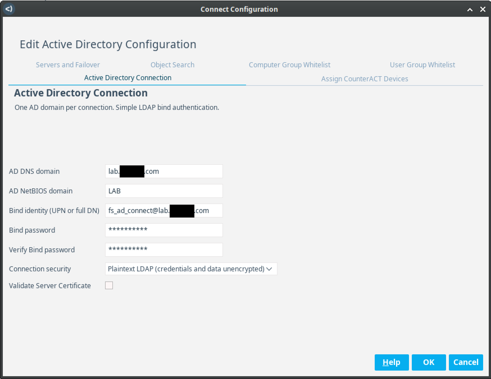

*Figure 1  Active Directory connection identity and transport settings*

### Assign CounterACT Devices

Choose the appliance that connects directly to the domain controllers and DNS resolvers. Then assign all devices by default or limit the connection to specific CounterACT devices, according to the deployment design.

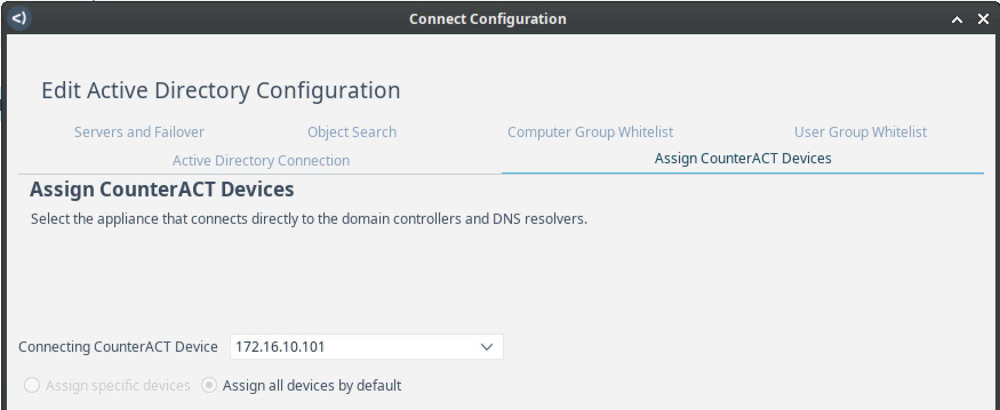

*Figure 2  Connecting appliance and CounterACT device assignment*

### Servers and Failover

- Select a **Find domain controllers** method and configure its required fields
  - `Configured AD servers in order` uses the listed domain controllers in sequence
    - A connection failure can move to the next server, but a successful not-found response is not retried against another server for a different answer
  - `DNS SRV discovery` queries the configured DNS resolver IPs for domain controllers in the AD DNS domain
- **Port override** set to `0` selects the transport default or advertised SRV port
  - A server entry with an explicit port takes precedence
- **Socket timeout** limits one network operation
- **Operation time budget** limits the overall request across discovery and failover attempts

> [!NOTE]
> A group write with an unknown outcome is not replayed on another domain controller. Action cancellation, when **Undo when action cancelled** is selected, uses the original action's responding domain controller.

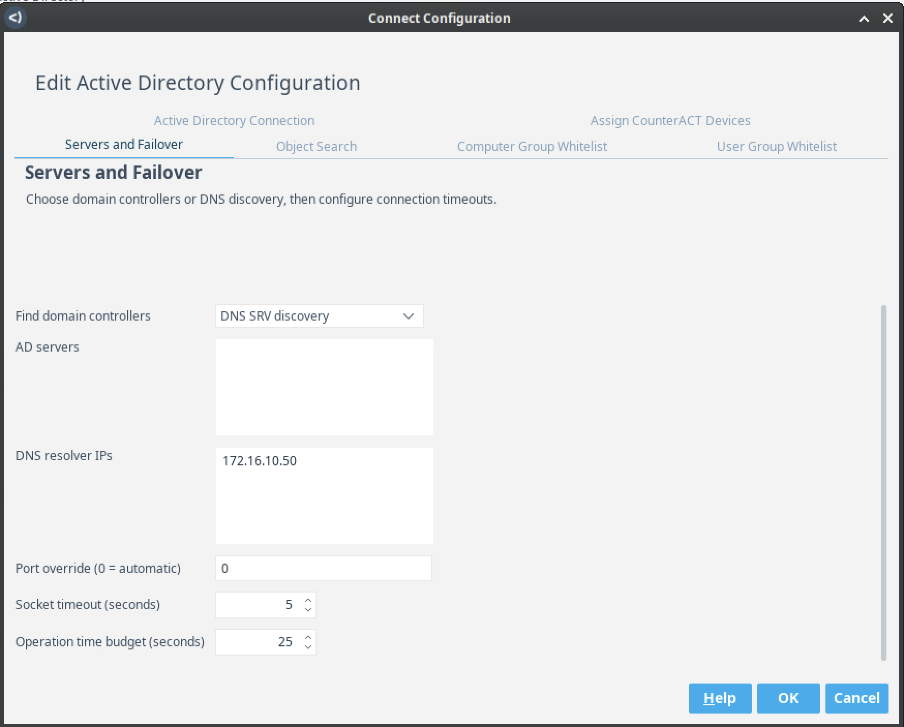

*Figure 3  Domain controller discovery, DNS resolvers, and timeout settings*

### Object Search

Leave a search base blank to use the domain naming context, or enter a full base DN to restrict the subtree searched for computer or user objects. Computer and user bases can be different. Group membership is selected by full group DN and can refer to groups elsewhere in the same domain.

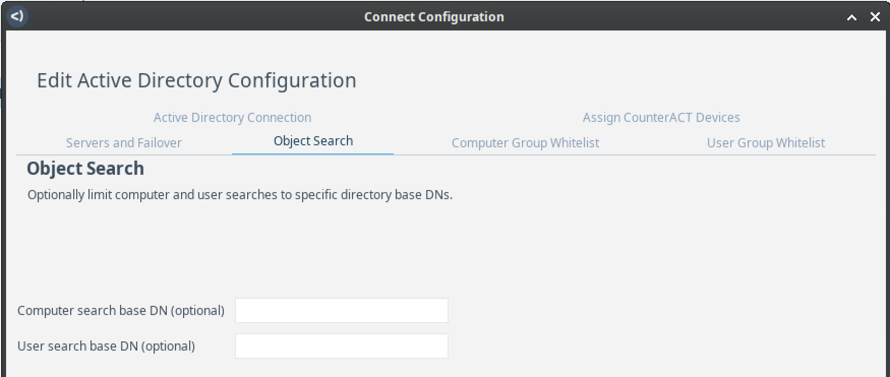

*Figure 4  Optional computer and user search base DNs*

### Computer Group Whitelist

Enter one full computer group DN per line. The whitelist applies to add, remove, and cancellation undo operations. A blank list blocks all computer group changes. Reporting membership does not require a group to be whitelisted. See [Configure the Group Whitelists](#configure-the-group-whitelists) for additional details.

> [!WARNING]
> Keep **Allow adding or removing computer accounts to or from any group** disabled. Enabling it bypasses the whitelist and permits changes wherever the bind account has write access.

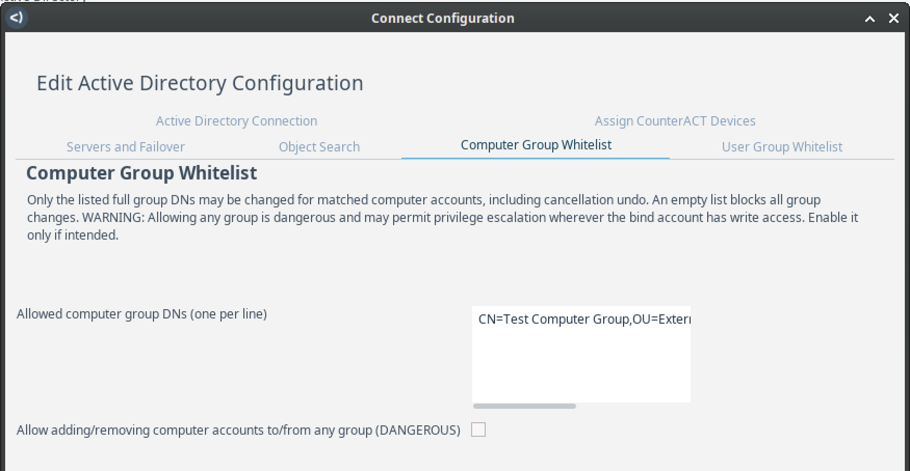

*Figure 5  Computer group whitelist and dangerous bypass option*

### User Group Whitelist

Enter one full user group DN per line. The whitelist applies to add, remove, and cancellation undo operations. A blank list blocks all user group changes. Reporting membership does not require a group to be whitelisted. See [Configure the Group Whitelists](#configure-the-group-whitelists) for additional details.

> [!WARNING]
> Keep **Allow adding or removing user accounts to or from any group** disabled. Enabling it bypasses the whitelist and permits changes wherever the bind account has write access.

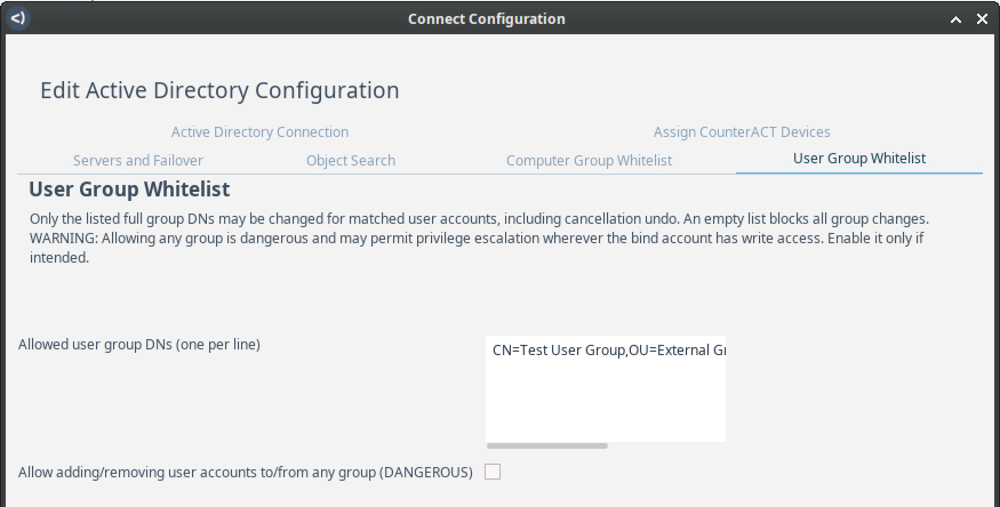

*Figure 6  User group whitelist and dangerous bypass option*

### Connection Validation

1. Click **OK** in the connection and System Description windows, then click **Apply** on the main Connect app configuration page
2. Select the Active Directory app row in the Connect Apps list and click **Edit**
3. Select the connection row and click **Test**; confirm DNS or configured-server discovery, TCP connectivity, TLS negotiation, bind authentication, and a directory search all succeed

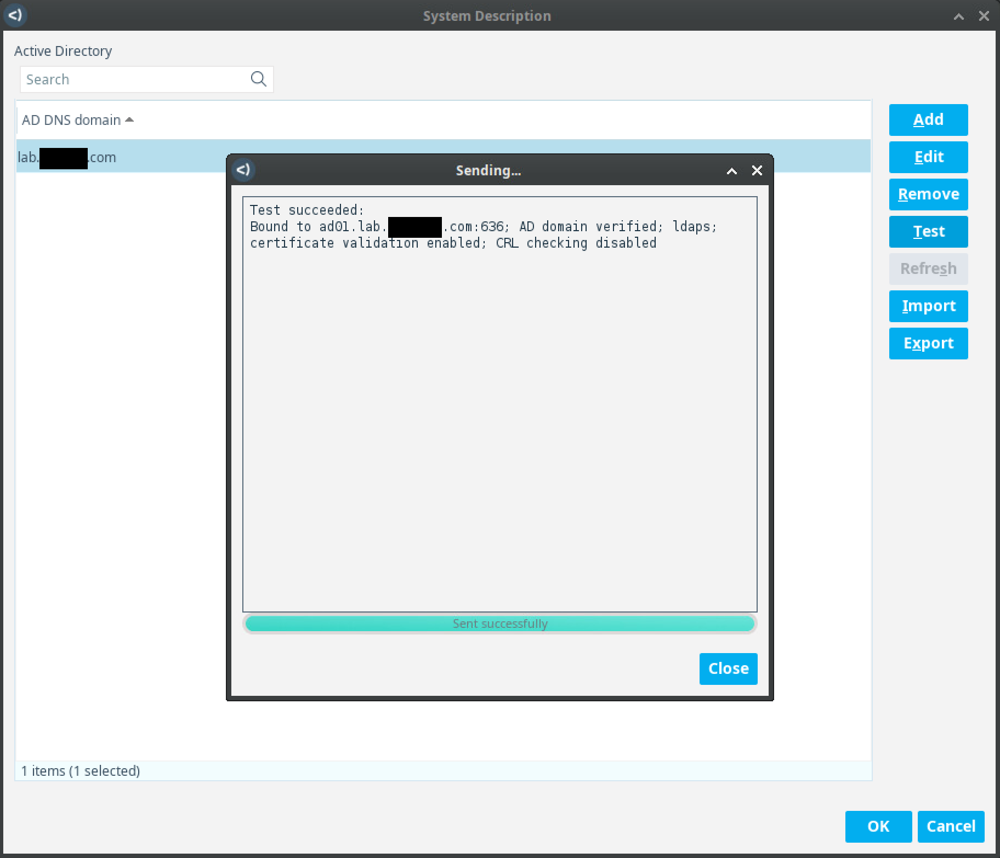

*Figure 7  Successful Active Directory connection test with LDAPS validation details*

## Import the Group Structure

Open **Forescout Group Manager** and import the supplied `Groups Structure.xml` file. The templates use the `Trusted Computer Object Match` and `Trusted User Object Match` groups to control LDAP resolution and protect write operations from low-confidence endpoint-to-AD-object matches. See [Require a Trusted Object Match](#require-a-trusted-object-match) before configuring write actions.

These are policy flow groups, not AD security groups. [**Computer Object Match Status**](#computer-object-match-status) and [**User Object Match Status**](#user-object-match-status) place endpoints into the corresponding trusted Forescout group only when the endpoint-to-AD-object match is sufficiently strong. This avoids low-confidence matches that could change group membership on the wrong AD object.

[**Computer Group Check**](#computer-group-check) and [**User Group Check**](#user-group-check) use the trusted groups as their main-rule gates. Membership in these Forescout groups does not itself change Active Directory.

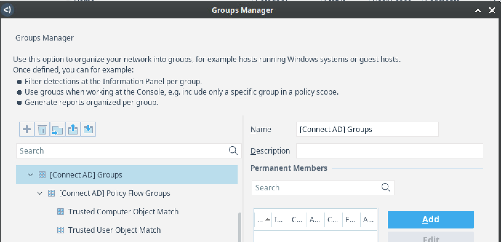

*Figure 8  Supporting policy flow groups*

## Deploy Policy Templates

### Included Policy Templates

| **Template location** | **Template** | **Purpose** |
| --- | --- | --- |
| Active Directory | [**Collect Computer/User Object GUIDs**](#collect-computeruser-object-guids-policy) | Collect exact computer and active-user `objectGUID` evidence from managed Windows endpoints. |
| Computer Object | [**1.0 Computer Object Match Status**](#computer-object-match-status) | Classify object-match confidence and populate the `Trusted Computer Object Match` gate. |
| Computer Object | [**1.1 Computer Group Check**](#computer-group-check) | Classify trusted computers by current direct and primary AD group membership. |
| User Object | [**1.0 User Cleanup on Logoff**](#user-cleanup-on-logoff) | Remove stale Connect AD user object and group properties after the endpoint has no logged-in user. |
| User Object | [**1.1 User Object Match Status**](#user-object-match-status) | Classify user-match confidence and populate the `Trusted User Object Match` gate. |
| User Object | [**1.2 User Group Check**](#user-group-check) | Classify trusted users by current direct and primary AD group membership. |

> [!IMPORTANT]
> Every supplied policy and action is disabled, and the exported segment is anonymized to `10.0.0.0/8`. Review and replace the scope, enable only the required actions, and then enable the policy.

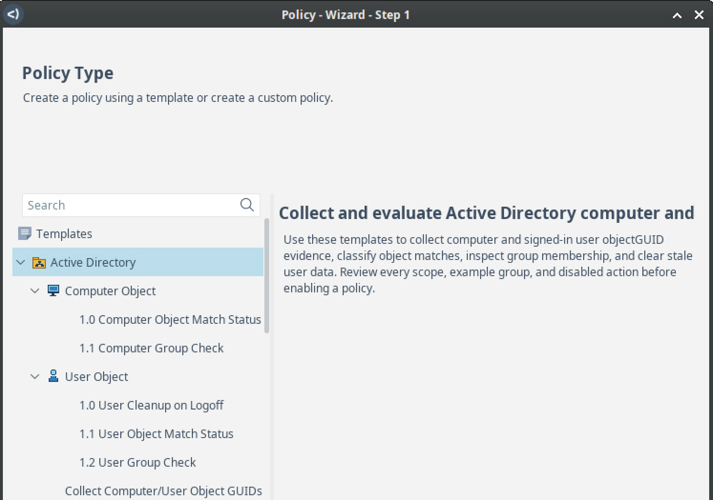

*Figure 9  Active Directory policy template hierarchy in the Policy Wizard*

> [!NOTE]
> Figure 9 was captured from version 0.3.32 and shows the former **User Objects** subgroup label. Version 0.3.33 and all current instructions use the corrected singular **User Object** label.

### Collect Computer/User Object GUIDs Policy

The collector runs one self-contained `.bat` file on Windows endpoints. The `.bat` contains its PowerShell payload and returns computer and signed-in user evidence in one JSON result. The app uses `objectGUID` for `Exact` confidence. Disconnected RDP users remain signed in until logoff and are included by the collector.

1. Open **Policy Editor > Add > Active Directory > Collect Computer/User Object GUIDs**
2. Adjust the policy name and description for the deployment
3. On **Scope**, select the intended segment or segments, typically **In-Scope**
4. On **Main Rule**, edit the condition and select the `Managed Windows Devices` group
5. Edit the **Collect computer and active user AD objectGUIDs** subrule, then edit its **Windows Expected Script Result** condition
6. Use the three-dot **Script Repository** button to upload `ConnectAD-CollectObjectGuids.bat`
  - Do not rename the script; confirm **Command or Script file** retains `ConnectAD-CollectObjectGuids.bat`
  - Set **Run Interactive** to `No`, **Match** to `Any Value`, and **Evaluate irresolvable criteria as** to `False`
7. Complete the wizard, start the policy, and confirm the script returns a JSON-formatted payload on endpoints

> [!NOTE]
> The template sets a two-minute **Admission Resolve** delay on the main rule so the collector can resolve reliably after a Windows endpoint starts or restarts. Adjust the delay only after validating endpoint behavior in the deployment environment.

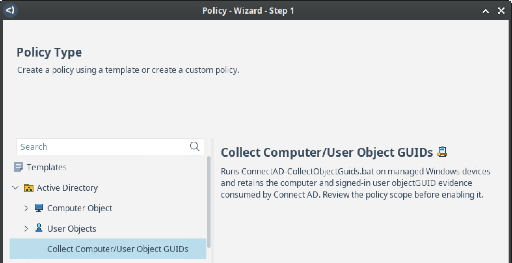

*Figure 10  Collect AD Object GUIDs template selection*

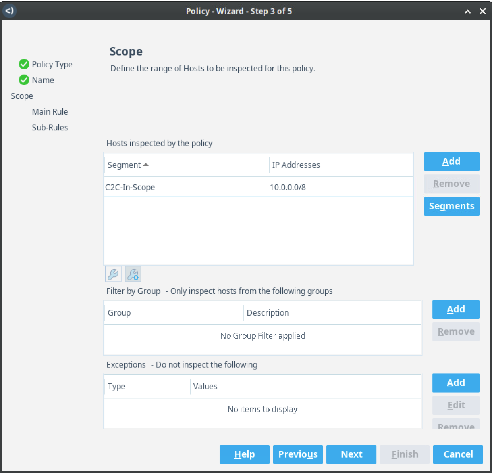

*Figure 11  Policy Scope page with production Forescout segment selection*

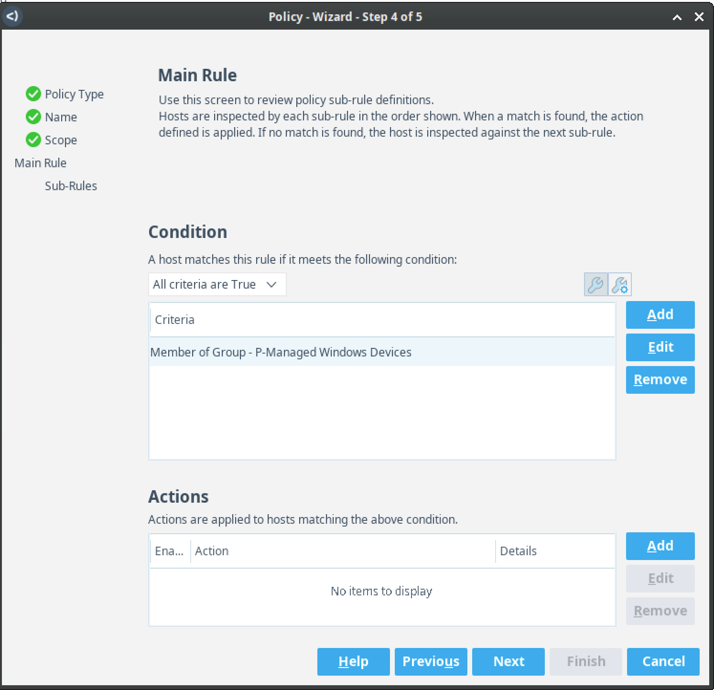

*Figure 12  Managed Windows device group on the collector main rule*

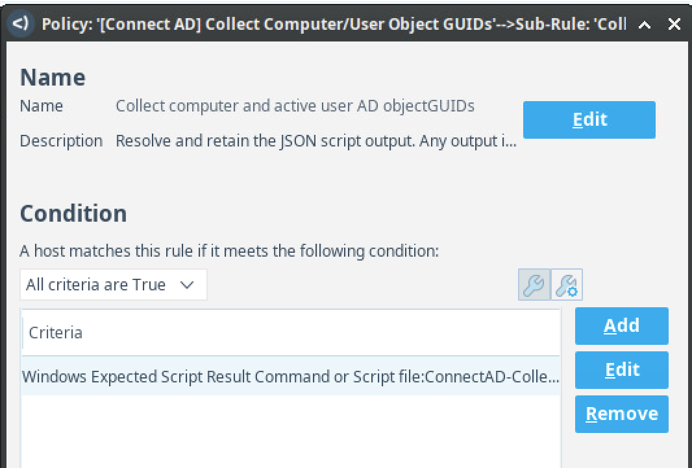

*Figure 13  Collector subrule and Windows Expected Script Result condition*

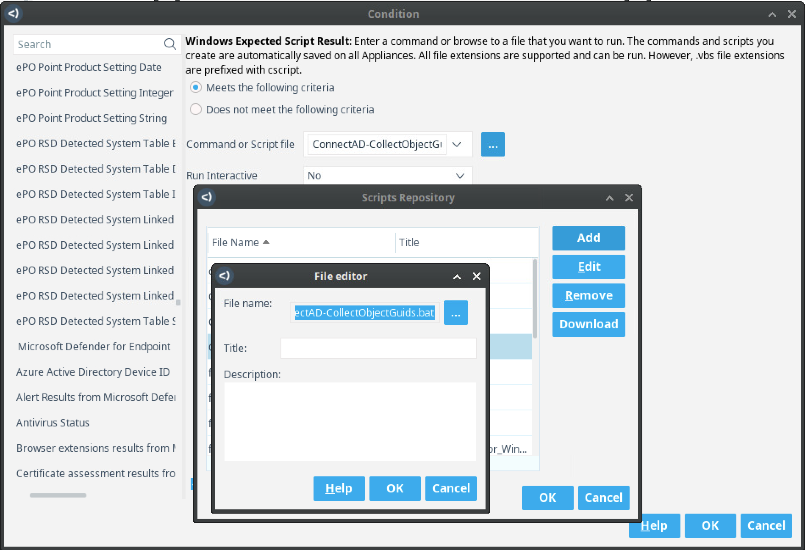

*Figure 14  Script repository upload and command file selection*

> [!NOTE]
> Importing or updating the app does not replace a BAT file already uploaded to the Windows script repository. Replace the stored file when the collector changes while retaining the exact filename so the policy's script-result property remains aligned.

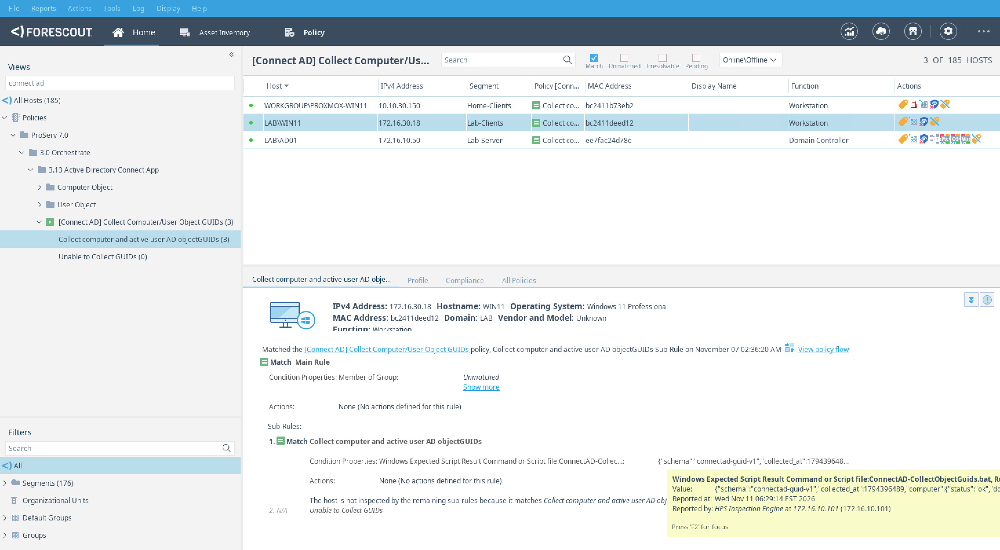

*Figure 15  Collect Computer/User Object GUIDs policy running on an endpoint*

### Computer Object Policy Templates

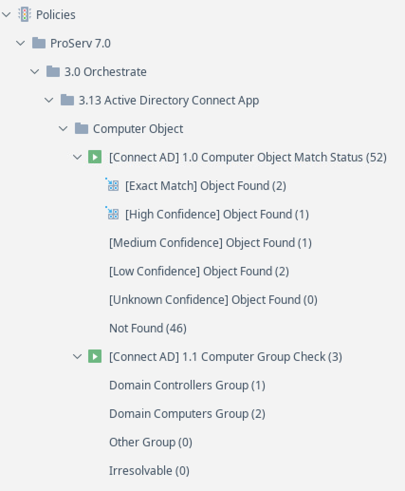

*Figure 16  Computer Object Match Status and Computer Group Check policies*

#### Computer Object Match Status

Use this template to separate successful computer matches by confidence and populate the trusted computer gate used by **Computer Group Check**.

> [!IMPORTANT]
> This base policy scopes resolution of **[Connect AD] Computer Object** to devices expected to have AD computer objects. Scope custom policies that use **[Connect AD] Computer Object**, **[Connect AD] Computer Groups**, **Add AD computer to group**, or **Remove AD computer from group** to devices in the `Trusted Computer Object Match` Forescout group maintained by this policy. This prevents excessive policy-resolution requests and LDAP queries.

1. Open **Policy Editor > Add > Active Directory > Computer Object > 1.0 Computer Object Match Status**
2. Adjust the policy name and description for the deployment
3. On **Scope**, select the intended segment or segments, typically **In-Scope**
4. Adjust the **Main Rule** conditions; by default, the policy searches for computer objects for Windows, macOS, and Linux endpoints
  - The app can find AD computer objects for Forescout unmanaged Windows devices or non-Windows endpoints
  - The collector provides an exact GUID, but computer-object resolution can fall back to `hostname`, `hostnames_list`, `nbthost`, `nbtdomain`, or `dhcp_hostname_v2`
  - Remove device groups that are outside the deployment or do not have corresponding AD computer objects to avoid excessive queries and policy resolution
5. Review the `Exact`, `High`, `Medium`, `Low`, `Unknown`, and `Not Found` subrules; Exact uses the collected GUID, High uses a NetBIOS hostname, Medium uses a DHCP hostname, and Low uses DNS evidence
6. Enable the standard Forescout **Add to Group** action on approved-confidence subrules to populate `Trusted Computer Object Match`; this action changes Forescout group membership and does not modify AD
  - `Exact` and `High` are the normal starting points
  - Do not trust `Medium`, `Low`, or `Unknown` unless the deployment explicitly accepts and validates that risk
7. Enable the policy and confirm a known endpoint enters `Trusted Computer Object Match` only at an approved confidence level

#### Computer Group Check

This policy evaluates only endpoints in `Trusted Computer Object Match` and resolves their current AD computer-group membership. Use it as the template for new computer-group check policies. The trusted-match-to-group-check flow avoids unnecessary LDAP queries and Forescout policy-resolution requests.

1. Open **Policy Editor > Add > Active Directory > Computer Object > 1.1 Computer Group Check**
2. Adjust the policy name and description for the deployment
3. On **Scope**, select the intended segment or segments, typically **In-Scope**
4. Confirm the main rule uses **Member of Group** with `Trusted Computer Object Match`
5. Replace or duplicate the example **Domain Controllers Group** and **Domain Computers Group** subrules for the AD groups to evaluate
  - Prefer an exact full group DN condition; the supplied friendly-name `Contains` examples are starting points and may match more broadly than intended
6. Use **Other Group** and **Irresolvable** as catch-all classifications as needed

> [!NOTE]
> **[Connect AD] Computer Groups** includes direct memberships and the account's primary group but does not expand nested group membership.

### User Object Policy Templates

> [!NOTE]
> Skip this section when the deployment needs only basic read-only logged-in-user group visibility and the native Forescout User Directory plugin supplies the required data. Complete it when GUID-backed user identity, Connect AD user properties, or Connect AD user group-membership writes are required.

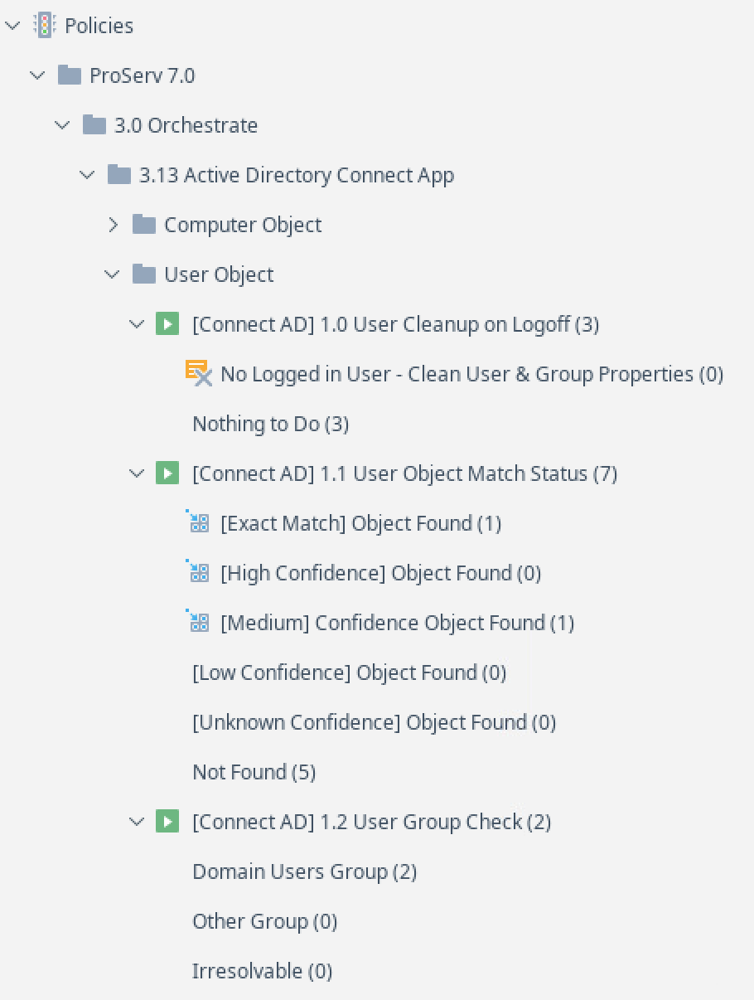

*Figure 17  User Object Match Status and User Group Check policies*

#### User Cleanup on Logoff

This template clears stale Connect AD user-match and user-group data when Forescout detects that no user remains logged in to a managed Windows endpoint. It reruns `ConnectAD-CollectObjectGuids.bat`, updates **[Connect AD] Managed User Object GUID Script Result**, and runs **Delete Properties** after a 30-second delay to remove **[Connect AD] User Object** and **[Connect AD] User Groups**.

1. Open **Policy Editor > Add > Active Directory > User Object > 1.0 User Cleanup on Logoff**
2. Adjust the policy name and description for the deployment
3. On **Scope**, select the intended segment or segments, typically **In-Scope**
4. On **Main Rule**, edit the condition and select the `Managed Windows Devices` group
5. Enable **Delete Properties** on the first subrule
  - If the matched user or group properties remain after logoff, increase the delay on **Schedule** and retest
  - A delay that is too short can race with the user-logoff event and leave stale values on the endpoint

> [!NOTE]
> The user-logoff event is driven by Forescout's built-in **Device Information > User** property. Connect AD user-match and group data is not cleared until that native property reports no logged-in user. SecureConnector normally updates it near real time; Remote Inspection may introduce additional delay.

#### User Object Match Status

Use this template to separate successful user matches by confidence and populate the trusted user gate used by **User Group Check**.

> [!IMPORTANT]
> This base policy scopes resolution of **[Connect AD] User Object** to devices expected to have AD user objects. Scope custom policies that use **[Connect AD] User Object**, **[Connect AD] User Groups**, **Add AD user to group**, or **Remove AD user from group** to devices in the `Trusted User Object Match` Forescout group maintained by this policy. This prevents excessive policy-resolution requests and LDAP queries.

1. Open **Policy Editor > Add > Active Directory > User Object > 1.1 User Object Match Status**
2. Adjust the policy name and description for the deployment
3. On **Scope**, select the intended segment or segments, typically **In-Scope**
4. Adjust the **Main Rule** conditions; by default, the policy searches for user objects for Windows, macOS, and Linux endpoints
  - The app can find AD user objects for Forescout unmanaged Windows devices or non-Windows endpoints
  - The collector provides an exact GUID, but user-object resolution can fall back to `user`, `va_comp_users_logged_in`, `linux_logged_users`, or `mac_logged_users`
  - These properties may be populated by host inspection or plugins such as RADIUS, Guest Portal, and HTTP Login
  - Remove device groups outside the deployment or without corresponding AD user objects to avoid excessive queries and policy resolution
5. Review the `Exact`, `High`, `Medium`, `Low`, `Unknown`, and `Not Found` subrules; Exact uses a collected GUID, High uses a domain-qualified username or UPN, and Medium uses an unqualified username in the configured domain
6. Enable the standard Forescout **Add to Group** action on approved-confidence subrules to populate `Trusted User Object Match`; this action changes Forescout group membership and does not modify AD
  - `Exact` and `High` are the normal starting points
  - Enable `Medium` only when unqualified usernames are explicitly acceptable and validated
7. Enable the policy and confirm a known endpoint enters `Trusted User Object Match` only at an approved confidence level

#### User Group Check

This policy evaluates only endpoints in `Trusted User Object Match` and resolves their current AD user-group membership. Use it as the template for new user-group check policies. The trusted-match-to-group-check flow avoids unnecessary LDAP queries and Forescout policy-resolution requests.

1. Open **Policy Editor > Add > Active Directory > User Object > 1.2 User Group Check**
2. Adjust the policy name and description for the deployment
3. On **Scope**, select the intended segment or segments, typically **In-Scope**
4. Confirm the main rule uses **Member of Group** with `Trusted User Object Match`
5. Replace or duplicate the example **Domain Users Group** subrule for each AD group to evaluate
  - Prefer an exact full group DN condition; the supplied friendly-name `Contains` example is a starting point and may match more broadly than intended
6. Use **Other Group** and **Irresolvable** as catch-all classifications as needed

> [!NOTE]
> **[Connect AD] User Groups** includes direct memberships and the user's primary group but does not expand nested group membership. A fresh account resolution is required for a write.

## Writing to Active Directory (Add/Remove Group Membership)

The app can change the direct AD group membership of the computer or current user matched to a Forescout device. This allows Forescout policy findings to drive controls in VPN concentrators, firewalls, Windows Group Policy, applications, deployment systems, and other products that already consume AD group membership. See [Group Change Use Cases](#group-change-use-cases) for example computer and user membership workflows and their downstream effects.

The app provides four actions under **Actions > Active Directory**:

- **Add AD computer to group**
- **Remove AD computer from group**
- **Add AD user to group**
- **Remove AD user from group**

Computer actions operate on the matched AD computer account. User actions operate on the freshly matched current AD user associated with the endpoint. Add and remove operations affect only the selected group's direct `member` attribute; they do not expand nested groups or reassign an account's AD primary group.

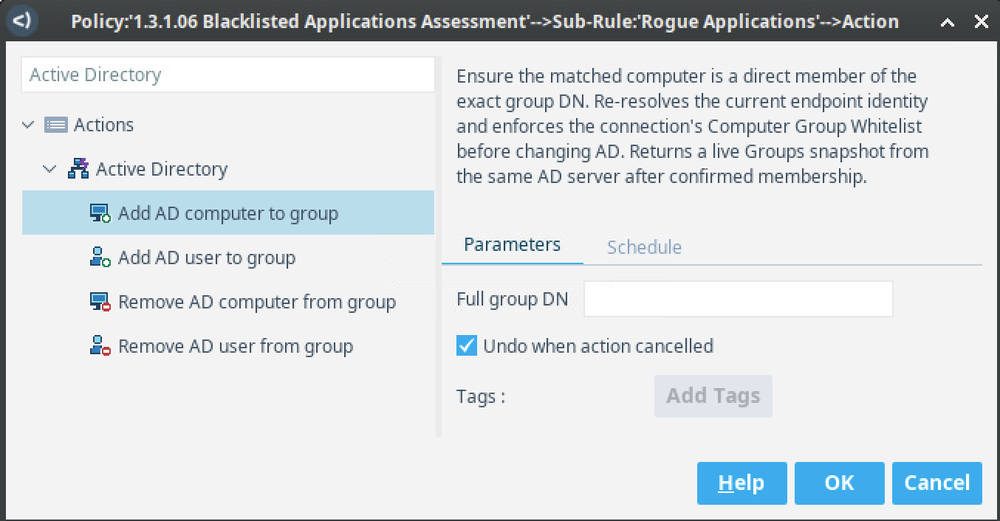

*Figure 18  Active Directory computer and user group-membership actions and parameters*

### Require a Trusted Object Match

> [!IMPORTANT]
> Run a computer or user write action only on devices that are members of the corresponding trusted Forescout group.

- Computer actions must be restricted to devices in `Trusted Computer Object Match`
- User actions must be restricted to devices in `Trusted User Object Match` and should also require a current logged-in user

The supplied Object Match Status policies maintain these Forescout groups. They prevent low-confidence or ambiguous endpoint-to-AD-object matches from changing the wrong AD account. `Exact` GUID matches provide the strongest evidence. `High` matches may also be approved when appropriate for the environment. Do not enable write actions for `Medium`, `Low`, `Unknown`, `Not Found`, `Irresolvable`, or otherwise untrusted matches without a separately reviewed design.

For a custom write policy, make membership in the appropriate trusted group part of the policy group scope, main rule, or same subrule that runs the action. Combine it with compliance policies that classify non-compliant endpoints and trigger the action.

Example computer action scope:

1. Device is a member of `Trusted Computer Object Match`
2. Device fails the intended compliance or security condition
3. The action targets an approved AD group by its exact full DN
4. The same DN is present in **Computer Group Whitelist**

Use the equivalent `Trusted User Object Match` flow for user actions.

### Full Group DN Is Required

Every action requires **Full group DN**. Enter the complete LDAP distinguished name of the target group, for example:

```text
CN=Restricted VPN Devices,OU=Security Groups,DC=example,DC=com
```

The action does not accept a display name, friendly name, partial DN, wildcard, or group CN by itself. The app verifies that the DN is inside the configured AD domain and performs a base-object lookup to confirm that it identifies exactly one visible AD group. Using a full DN distinguishes groups that have the same name in different OUs.

The DN can be copied from the group's `distinguishedName` attribute in Active Directory Users and Computers with **View > Advanced Features** enabled, or retrieved with an administrative tool such as:

```powershell
Get-ADGroup -Identity "Restricted VPN Devices" | Select-Object -ExpandProperty DistinguishedName
```

### Configure the Group Whitelists

The Connect app System Description at **Options > Connect > Active Directory > Edit >** `<AD DNS domain>` **> Edit** has separate allowlists for computer and user changes:

- **Computer Group Whitelist** controls computer add and remove actions
- **User Group Whitelist** controls user add and remove actions

Enter one [complete group DN](#full-group-dn-is-required) per line. The action's **Full group DN** must match an entry in the applicable whitelist. DN comparison is case-insensitive and follows DN component boundaries; prefixes, substrings, wildcards, and a same-named group in a different OU do not authorize the action.

A blank whitelist blocks all add, remove, and cancellation-undo writes for that object type. It does not prevent the app from reporting group membership. This fail-closed default makes it possible to deploy and validate read-only resolution before authorizing any changes and prevents changes to unintended AD groups if the bind user has overly broad access.

> [!WARNING]
> Keep **Allow adding/removing computer accounts to/from any group** and **Allow adding/removing user accounts to/from any group** disabled. These options bypass the corresponding whitelist and can permit privilege escalation anywhere the bind account has write access. If either bypass is exceptionally required, document the reason, restrict the bind account independently, and test the effective scope before enabling a production action.

The whitelist is enforced again during cancellation undo. Removing a group from the whitelist prevents a later action cancellation from changing that group.

### Delegate the Bind Account Permission

The bind identity requires read access to the computer, user, and group objects used by the app. To change membership, it additionally needs permission to write the `member` attribute on each approved target group. It does not need broad write access to the computer or user OUs.

For a small number of target groups, grant access directly on each group:

1. Open Active Directory Users and Computers and enable **View > Advanced Features**
2. Open the approved target group's **Properties > Security > Advanced** page
3. Add the dedicated Connect AD bind identity
4. Grant the property-specific permission to write the group's **Members** or `member` attribute, applying it to that group object only
5. Retain the normal read permissions needed to resolve the account and group
6. Repeat for each DN entered in the computer or user whitelist

For many approved groups, place only those groups in a dedicated OU and use the Delegation of Control wizard or an equivalent ACL process to grant the bind identity permission to modify group membership on group objects in that OU. Do not place privileged or unrelated groups in the delegated OU. The AD ACL and the app whitelist should independently restrict the same intended group set.

Avoid granting `GenericAll`, full control, write-all-properties, or broad write permission over user and computer objects. Begin with a dedicated nonprivileged test group and confirm that authorized writes succeed while an unlisted or nondelegated group fails.

### How the Action Is Performed

Before every forward write, the app freshly resolves the current computer or user rather than trusting a cached account DN. It then:

1. Validates the action's full group DN against the applicable connection whitelist
2. Resolves the DN as one AD group and records its `objectGUID`
3. Rechecks the account and group GUIDs immediately before the write
4. Compares the group's direct `member` value to determine whether a change is needed
5. Sends one LDAP modification for the single account DN when necessary
6. Verifies the resulting membership on the same domain controller
7. Re-reads the account by GUID and publishes a complete live **[Connect AD] Computer Groups** or **[Connect AD] User Groups** snapshot

The actions are idempotent. Adding an existing member returns `Already present` and removing an absent member returns `Already absent` without sending an unnecessary modification. Adding an account to its current primary group is also an already-present result. Removing an account's primary group is rejected because primary-group reassignment is not supported.

If a write is sent but its result cannot be verified, the action returns `Unknown`. The app does not retry that write against another domain controller because doing so could duplicate or reverse a change whose first outcome is unknown. Re-read membership before attempting another action.

### Undo When Action Cancelled

**Undo when action cancelled** is enabled by default. When the forward action succeeds, the app records whether the account was originally a member, whether the action changed anything, the account and group GUIDs, the configured domain, and the domain controller that confirmed the result.

When Forescout later invokes action cancellation, the app restores the original membership only when:

- The checkbox was enabled when the forward action ran
- The original action actually changed membership; a no-op does not claim ownership of existing state
- The account and group still have the recorded GUIDs
- The connection still represents the same AD domain
- The group remains permitted by the current whitelist
- The original confirming domain controller remains in the connection configuration and is reachable

Undo is performed on the original domain controller to avoid acting on a replica that may not yet contain the confirmed change. A failed or unknown forward action has no successful action record to reverse, so cancellation does not attempt a blind opposite write.

Leave automatic undo enabled when group membership should exist only while a policy condition remains true. Examples include a temporary restricted VPN profile, a remediation group, or a time-bounded access entitlement.

Disable automatic undo when the change should remain until a separate workflow or administrator explicitly clears it. Common reasons include:

- Incident-response containment must not disappear because a transient detection clears
- Remediation requires human approval or a different compliance policy before access is restored
- The group starts an asynchronous deployment or investigation that must finish after the original policy no longer matches
- AD replication, Kerberos token refresh, Group Policy refresh, VPN reauthentication, or application caching requires the membership to remain stable long enough to take effect
- Disabling or editing the Forescout policy must not unexpectedly restore access

When undo is disabled, build an explicit removal policy or operational procedure so the membership does not become permanently stale.

### Operational Timing and Recovery

AD group membership changes are durable directory state, but their downstream effect may be delayed by AD replication, Kerberos ticket or computer-token refresh, sign-out/sign-in, restart, Group Policy refresh, VPN reauthentication, or application caching. Do not treat an AD group action as an instantaneous disconnect or emergency kill switch.

For every production write workflow:

1. Use purpose-built, nonprivileged target groups
2. Require the appropriate trusted Forescout match group
3. Whitelist only the exact target DNs
4. Delegate the bind identity only the required `member` write permission
5. Validate read-only object and group resolution first
6. Test add, no-op, remove, cancellation, failed authorization, and unknown-outcome handling with nonprivileged accounts
7. Document whether cancellation should undo the change and how persistent membership will otherwise be removed
8. Confirm the downstream system's replication, token, refresh, and caching behavior before relying on the control

## Enablement and Validation

### Read-Only Validation

1. Confirm the app update and connection changes have been applied
2. If computer data is in scope, resolve a known computer and verify its **[Connect AD] Computer Object** match method, confidence, DN, GUID, lookup time, and responding domain controller
3. If computer group data is in scope, resolve **[Connect AD] Computer Groups** and confirm the expected direct and primary memberships; confirm nested-only memberships are not reported
4. If the GUID collector is enabled, confirm the raw script result updates and **[Connect AD] Managed Computer Object GUID Script Result** and **[Connect AD] Managed User Object GUID Script Result** contain the expected collection status
5. If Connect AD user properties are in scope, sign in with a known domain user and verify the **[Connect AD] User Object** match method, confidence, DN, GUID, lookup time, and responding domain controller
6. If Connect AD user groups are in scope, resolve **[Connect AD] User Groups** and confirm the expected direct and primary memberships; confirm nested-only memberships are not reported
7. If **User Cleanup on Logoff** is deployed, log off the domain user and confirm the stale **[Connect AD] User Object** and **[Connect AD] User Groups** properties are cleared before another user becomes eligible for policy or action processing
8. For a basic read-only user deployment that does not require Connect AD user properties, confirm the native User Directory plugin provides the logged-in-user group data required by policies; leave the **User Object** templates and all write actions disabled

### Write Workflow Validation

1. Use a dedicated test account for each deployed object type and a nonprivileged test group
2. Confirm the endpoint enters `Trusted Computer Object Match` or `Trusted User Object Match`, as applicable, only at an approved confidence level
3. Confirm **Computer Group Check** or **User Group Check**, as applicable, sees the current membership before enabling a write action
4. Verify the target is a full group DN, appears in the correct whitelist, and is writable by the bind account
5. Run one add and one remove test; confirm the action reports success, the responding AD server is recorded, and the refreshed **[Connect AD] Computer Groups** or **[Connect AD] User Groups** property matches AD
6. Test action cancellation only while the target group remains whitelisted; undo uses the original action's domain controller and does not bypass current safeguards
7. For user writes, test login, disconnected RDP, logoff, local login, and a new domain login; confirm no previous user remains eligible for an action after the session changes
