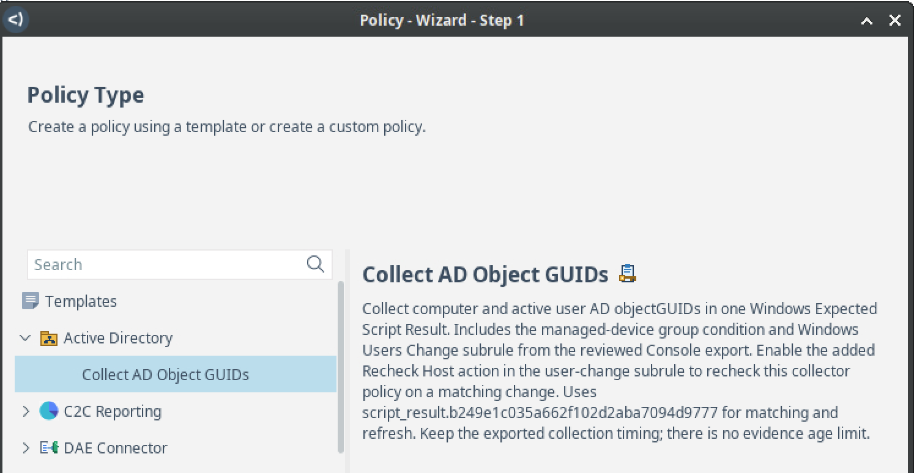
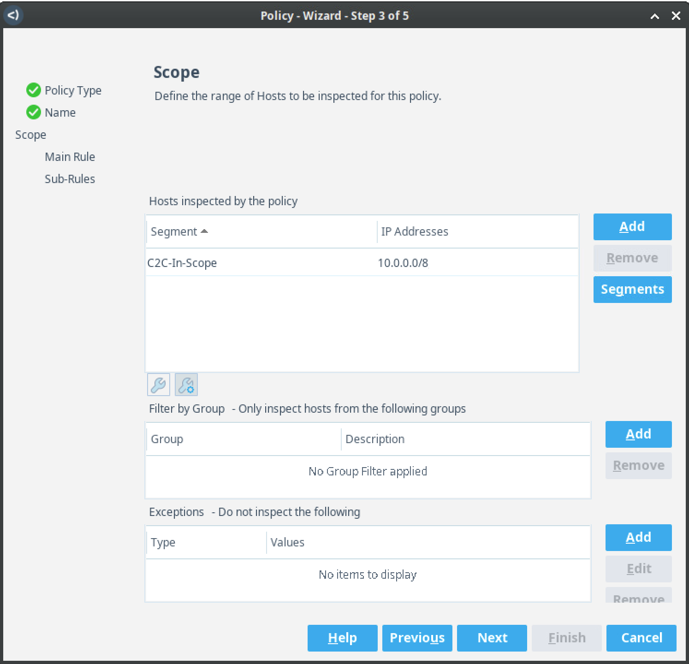
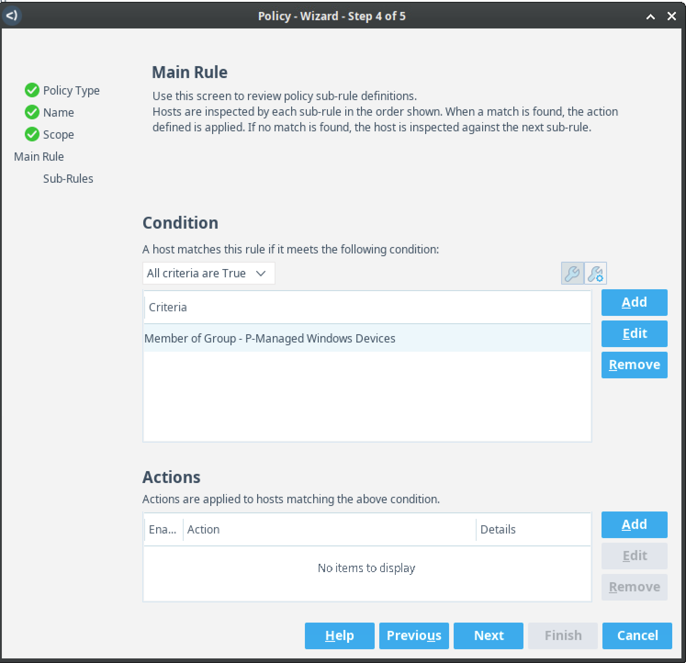
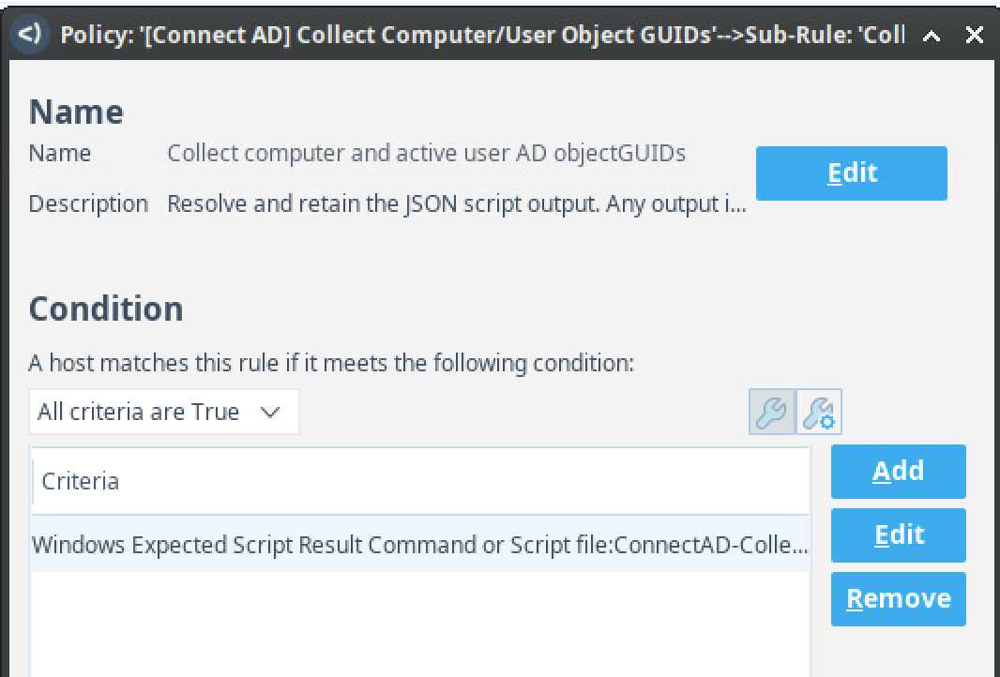
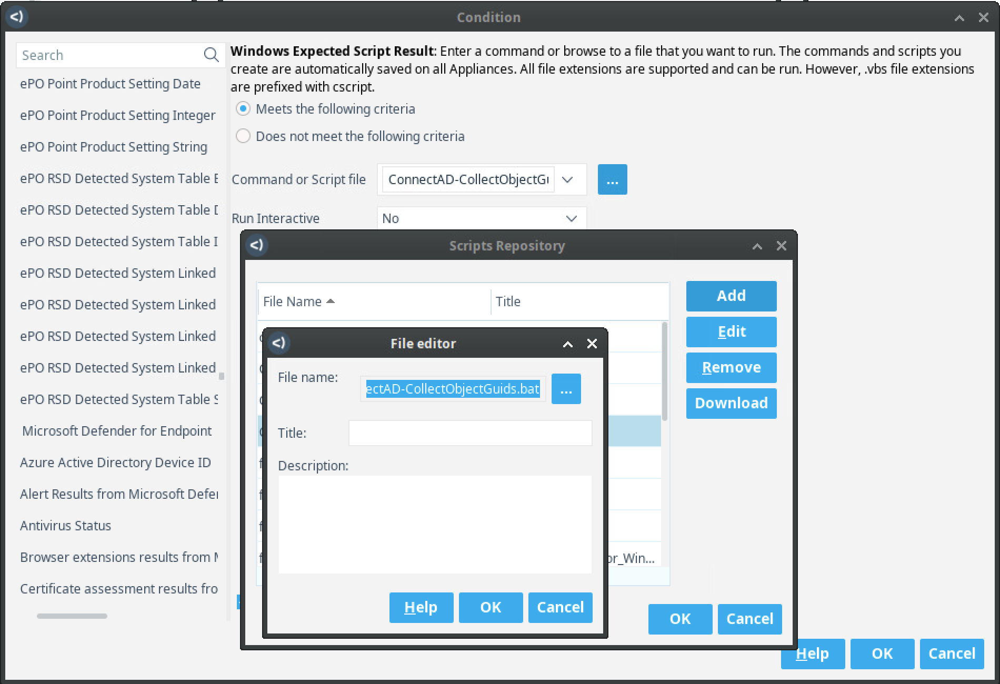

# Install the GUID collector

[`ConnectAD-CollectObjectGuids.bat`](ConnectAD-CollectObjectGuids.bat) is the
only endpoint collector to upload. It is self-contained: the PowerShell payload
is embedded in the BAT, so there is no separate PS1 to upload or select.

1. In the Policy Manager, add a policy from **Templates > Active Directory >
   Collect Computer/User Object GUIDs**.

   

2. Name the policy. On the **Scope** page, select **Segments**, remove the
   exported example segment, and add the production segment or segments that
   contain the managed Windows endpoints this policy should inspect. Confirm
   the resulting IP ranges before continuing.

   

3. On the **Main Rule** page, edit the condition and select the intended managed
   Windows device group.

   

4. Edit the **Collect computer and active user AD objectGUIDs** subrule, then
   open its **Windows Expected Script Result** condition.

   

5. Next to **Command or Script file**, select the three-dot Script Repository
   button. Upload `ConnectAD-CollectObjectGuids.bat`, select that exact filename,
   and leave **Run Interactive** set to **No**.

   

6. Complete the policy wizard, review the exported collection timing and all
   actions, and enable the policy only after the BAT is available on every
   applicable appliance.

When the collector changes, replace the stored BAT while retaining the exact
filename and policy parameters. Importing or updating the Connect app does not
replace the Script Repository file. Selecting a different script or changing
the script parameters can create a different `script_result.*` property that is
not wired to this app.
